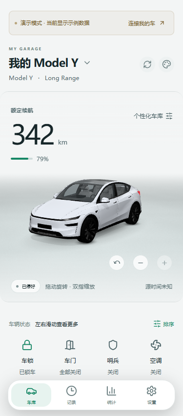
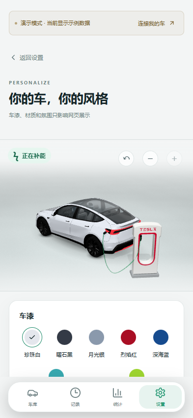
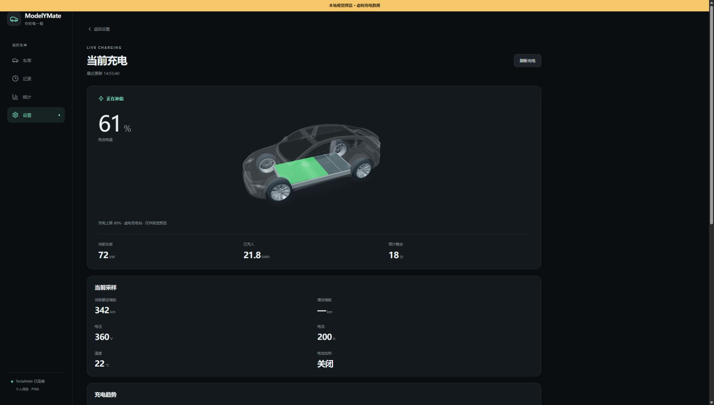
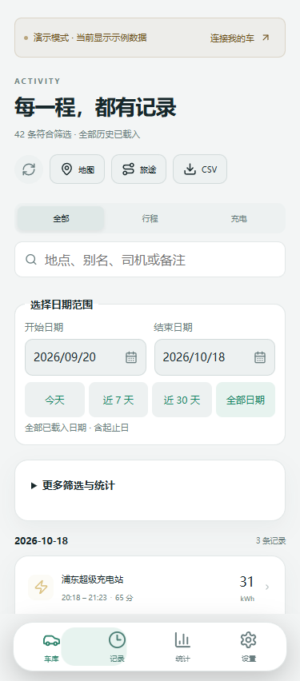
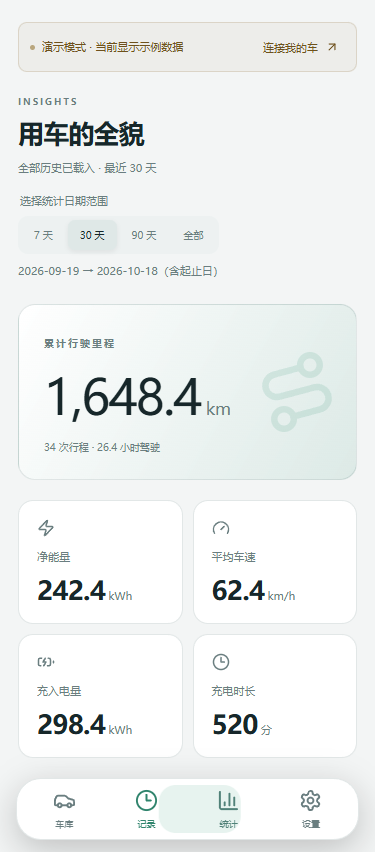
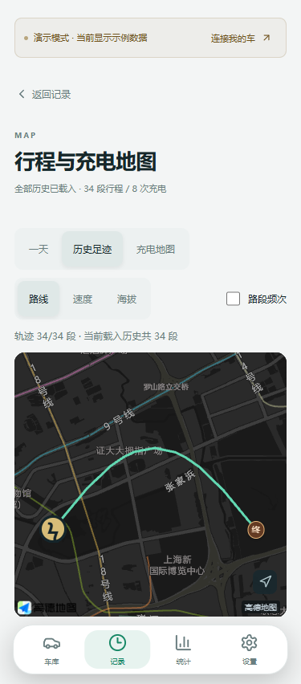
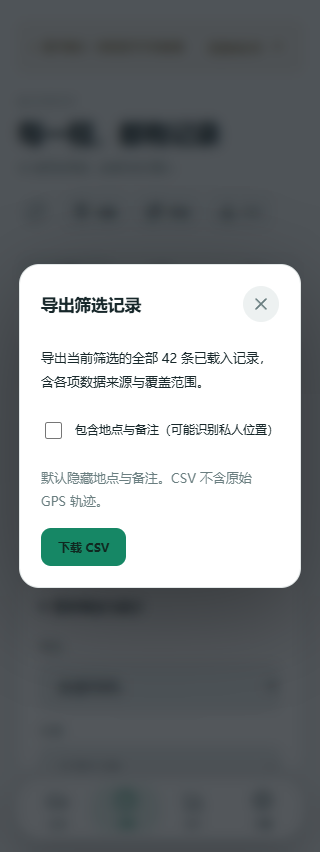
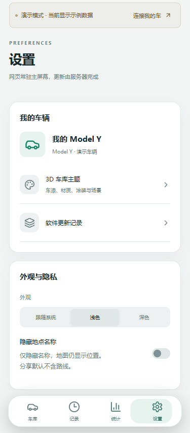
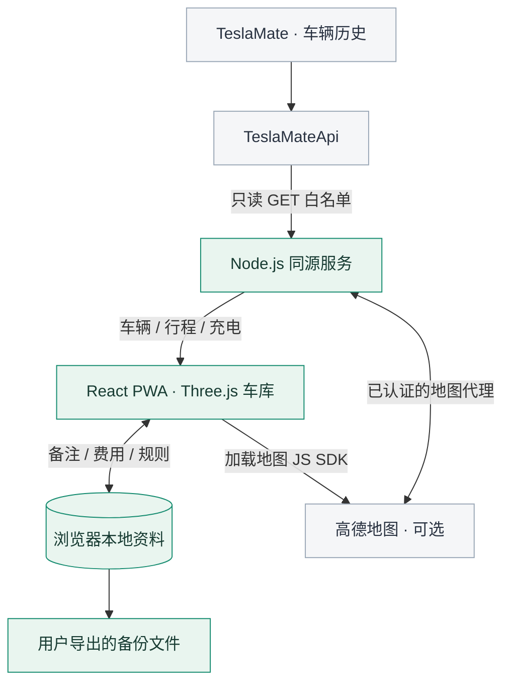

<div align="center">


# ModelYMate

**你的每一程，直观可见。**

TeslaMate 可视化网页 · 3D Model Y 车库 · 个人自托管 PWA

[](LICENSE)
[](THIRD_PARTY_NOTICES.md)


<br>


[](#开发与检查)

[功能预览](#1-功能) · [系统架构](#2-系统架构) · [安装启动](#3-安装与运行) · [首次配置](#4-首次配置) · [许可证](#5-许可证与鸣谢)

</div>

## 1. 功能

以下截图均来自 ModelYMate 的**虚构演示数据**。窄屏截图用于展示手机布局，充电图为桌面视图；不代表真实车辆记录或物理手机验收。

<p align="center">
<a href="docs/screenshots/screenshot-dashboard.png"></a>
<br><b>车辆状态</b> — 电量、续航和车门状态汇聚在首页，拖动模型即可换个角度看车。
</p>

<p align="center">
<a href="docs/screenshots/screenshot-garage.png"></a>
<br><b>个性化车库</b> — 切换车漆与展厅氛围，查看车门开合、内饰和连桩充电动画。
</p>

<p align="center">
<a href="docs/screenshots/screenshot-charging.jpg"></a>
<br><b>充电透视</b> — 半透明车身展示电池补能，电量、充电功率和预计时间放在同一张卡片里。
</p>

<p align="center">
<a href="docs/screenshots/screenshot-records.png"></a>
<br><b>行程与充电记录</b> — 按日期、地点、司机或备注查找记录，把一段出行整理成旅途。
</p>

<p align="center">
<a href="docs/screenshots/screenshot-statistics.png"></a>
<br><b>用车统计</b> — 汇总一段时间的里程、能耗、充电量与费用，查看自己的用车变化。
</p>

<p align="center">
<a href="docs/screenshots/screenshot-history-map.png"></a>
<br><b>行程与充电地图</b> — 在地图上浏览历史足迹与充电点，进入行程详情回放路线和采样曲线。
</p>

<p align="center">
<a href="docs/screenshots/screenshot-export.png"></a>
<br><b>记录导出</b> — 将筛选后的记录保存为 CSV，导出前决定是否包含地点与备注。
</p>

<p align="center">
<a href="docs/screenshots/screenshot-settings.png"></a>
<br><b>外观与隐私</b> — 浅色、深色或跟随系统，按需要隐藏地点名称、调整车库展示。
</p>

此外还提供电池健康估计、电价规则、费用校正、地点别名、司机管理、本地资料备份与恢复。**所有车辆操作均为数据查看；车库动画不会发送解锁、唤醒或其他车辆控制命令。**

## 2. 系统架构



| 部分 | 技术与职责 |
| --- | --- |
| 网页界面 | React + TypeScript，负责页面、状态与交互 |
| 3D 场景 | Three.js，负责模型、材质、车门与充电动画 |
| 同源服务 | Node.js + JavaScript，负责会话、只读 API 和地图代理 |
| 本地资料 | 当前浏览器存储，支持手动导出、恢复与撤销 |
| 构建 | Vite + pnpm，生成可独立运行的前端 |

本项目对接已有 **TeslaMateApi** 的 `/api/v1/` 接口，不直接连接 PostgreSQL，也不附带 TeslaMate 或数据库。浏览器中的 TypeScript 会在构建时转换为 JavaScript。

## 3. 安装与运行

需要 **Node.js 24** 和 **pnpm 11.25.0**。

```sh
git clone https://github.com/Franky-01/ModelYMate.git
cd ModelYMate
pnpm install --frozen-lockfile
pnpm run build:frontend
pnpm start
```

终端显示 `ModelYMate PWA http://127.0.0.1:5180` 后，打开 [http://127.0.0.1:5180](http://127.0.0.1:5180)。

**首次启动即可使用内置演示，不需要车辆凭据。** 未配置地图时，地图不可用，其他演示功能仍可体验。首次加载 3D 模型约需下载 23.8 MB 资源，之后可由浏览器缓存。

### 在自己的设备上使用

服务默认只监听本机回环地址 `127.0.0.1:5180`。手机或另一台电脑访问时，应通过你自己已配置好的受保护网络与 HTTPS 反向代理访问；项目不会自动配置公网入口、数据库或网络权限。

`dist/` 是前端构建产物。真实车辆连接和地图代理需要配套的 Node 服务，不能只把静态文件上传到 GitHub Pages 就完成全部部署。

### 开发与检查

开发时保持两个终端运行：

```sh
# 终端一：同源 API 服务
pnpm start
```

```sh
# 终端二：前端热更新
pnpm dev
```

访问 [http://127.0.0.1:5178](http://127.0.0.1:5178)。Vite 会将 API 和地图代理请求转发到 5180 端口。

```sh
pnpm test
pnpm run build:frontend
```

2026-11-12 发布源码的本地验证：**188/188 项测试通过，TypeScript 检查与前端构建通过**。这是本地验证记录；物理 iPhone Safari/PWA、移动设备性能和实车联动需在自己的环境中验证。`pnpm build` 与 `pnpm run build:frontend` 等效，构建会更新 `public/sw.js` 的缓存版本。

## 4. 首次配置

### 4.1 准备自己的配置文件

在项目根目录将 `.env.example` 复制为 `.env.local`：

```sh
# Linux / macOS
cp .env.example .env.local
```

```powershell
# Windows PowerShell
Copy-Item .env.example .env.local
```

只在自己的设备上填写真实值。配置文件已经被 Git 忽略；修改后需要重启 `pnpm start`。

### 4.2 连接 TeslaMateApi

把 `TESLAMATE_BASE_URL` 改成自己的 HTTPS TeslaMateApi 网关地址：

```dotenv
TESLAMATE_BASE_URL=https://teslamate.example.invalid
```

上面的 `.invalid` 是占位域名，需要替换。这里填写的是 **TeslaMateApi 网关**，不是 Tesla 账号页面，也不是 PostgreSQL 地址。

| 配置 | 用途 |
| --- | --- |
| `TESLAMATE_BASE_URL` | 自己的 HTTPS TeslaMateApi 网关地址 |
| `TESLAMATE_INTERNAL_URL` | 可选的服务端内部上游地址 |
| `TESLAMATE_AUTHORIZATION_FILE` | 可选的服务端认证文件路径；内容仅由服务端读取 |
| `HOST` / `PORT` | 默认 `127.0.0.1` / `5180` |

重启服务后，在网页打开 **设置 → TeslaMate 连接**：

1. 输入上游要求的完整认证信息，例如自己的 `Bearer …`。
2. 点击 **连接我的 TeslaMate**。
3. 服务端验证成功后建立浏览器会话，网页切换到真实数据。

认证信息由服务端处理，不写入浏览器的本地备注或备份。已有受信代理方案也可接入；仅填写服务端认证值不会自动授权所有访问者。

<details>
<summary>仅在本机 HTTP 环境测试真实连接</summary>

默认会话 Cookie 启用 `Secure`，正式使用应保留 HTTPS。如果仅在本机回环地址测试登录，可在 `.env.local` 添加：

```dotenv
SESSION_COOKIE_SECURE=false
```

该选项只允许非生产、回环地址开发环境。浏览虚构演示不需要修改它。远程访问应保持默认 Secure Cookie，并让反向代理正确传递请求 Host；详细边界见 [安全说明](SECURITY.md)。

</details>

### 4.3 配置地图（可选）

到 [高德开放平台控制台](https://console.amap.com/) 为自己的应用创建 **Web 端（JS API）** Key，取得配套的安全密钥，然后填写：

```dotenv
AMAP_KEY=自己的_JSAPI_Key
AMAP_SECURITY_CODE=与_Key_配套的安全密钥
```

重启服务后，在已登录或已有受信代理身份的网页中查看地图。JSAPI Key 会提供给浏览器；安全密钥由 Node 地图代理使用，不返回给前端。本项目没有单独的 `AMAP_WEB_KEY` 配置。

地图、逆地理编码与道路补线可能向高德发送相应显示坐标，服务条件与额度以自己的高德配置为准。隐藏地点名称只影响文字显示，地图仍会显示位置。

### 4.4 添加到主屏幕

在 iPhone Safari 打开自己的 HTTPS 网站，点 **分享 → 添加到主屏幕**。设置页内也有安装提示。

首次成功加载的页面外壳与 3D 资源可供离线使用；车辆 API、认证和地图响应不进入 Service Worker 缓存，离线时车辆状态不会继续更新。

### 4.5 保存本地资料

在 **设置 → 本车本地资料** 中选择要导出的备注、费用、电价规则、旅途、健康快照、地点别名或司机名单。

恢复前可预览范围，并可撤销最近一次恢复。资料按来源和车辆保存在当前浏览器，手机与电脑不会自动同步；更换域名、浏览器或清除站点数据前，请先导出备份。CSV 用于查看记录，本地资料备份用于恢复个人填写的内容。

## 5. 许可证与鸣谢

- **项目原创代码：** [MIT](LICENSE) © 2026 Franky-01 and ModelYMate contributors。
- **车辆模型：** BloxBloger 的 2025 Tesla Model Y，采用 [CC BY-NC 4.0](https://creativecommons.org/licenses/by-nc/4.0/)，仅限非商业使用；保留现有署名、转换和修改记录。模型不属于 MIT 授权范围。
- **第三方代码与素材：** 见 [THIRD_PARTY_NOTICES.md](THIRD_PARTY_NOTICES.md) 和 [完整模型鸣谢](public/assets/CREDITS.md)。
- **README 展示结构参考：** [my-tesla](https://github.com/kinopico-zhang/my-tesla)。本文内容与截图展示 ModelYMate 自身功能；截图中的含模型内容继续遵守模型许可。

本项目与 Tesla, Inc. 无隶属或背书关系。Tesla 与 Model Y 名称用于说明兼容对象和模型来源。
